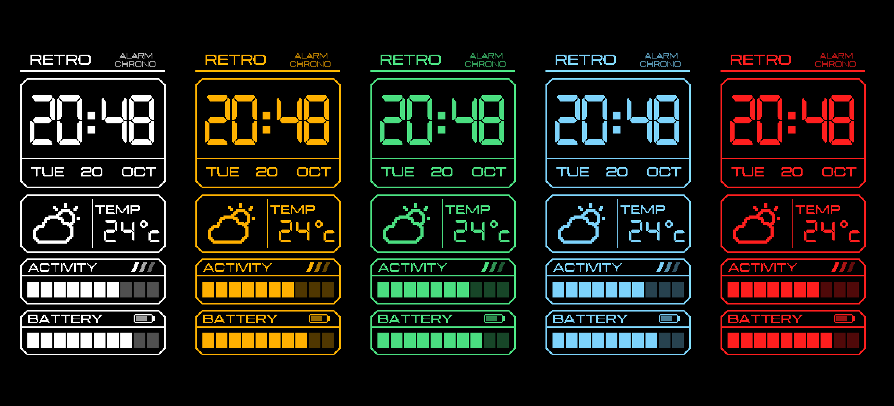
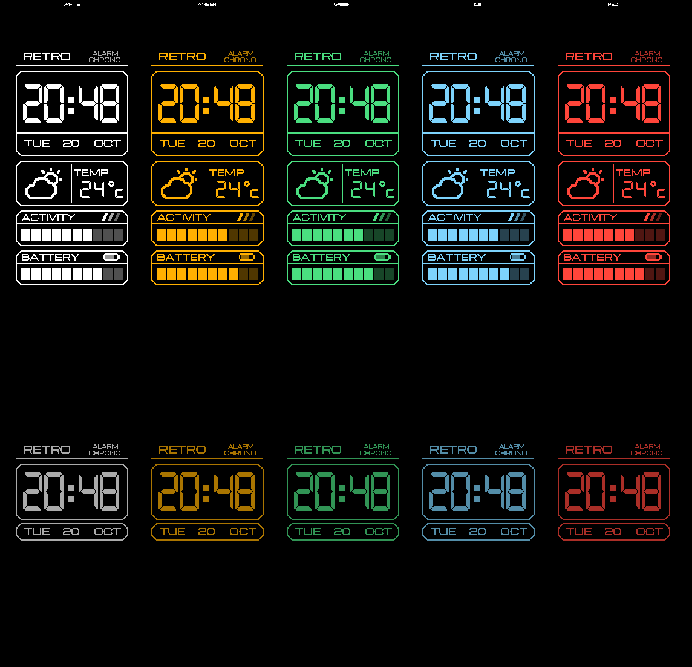

# RETRO LCD

A retro-inspired LCD watch face for the **Xiaomi Smart Band 10** - five
colorways, always-on display included.

White-on-black vintage LCD style: big 7-segment time (24h), weekday /
date / month, weather condition + temperature, a 10-segment step-goal bar,
a battery bar + icon - and a dimmed miniature of it all as the AOD.

## Colorways

| File | Hue |
|---|---|
| [watchface-WHITE.bin](watchface-WHITE.bin) | classic white |
| [watchface-AMBER.bin](watchface-AMBER.bin) | amber `#FFB000` |
| [watchface-GREEN.bin](watchface-GREEN.bin) | LCD green `#4ADE80` |
| [watchface-ICE.bin](watchface-ICE.bin) | ice blue `#7DD3FC` |
| [watchface-RED.bin](watchface-RED.bin) | LED red `#FF1E1E` |

Every colorway is one hue expressed as a luminance ladder - primary ink,
secondary, dim levels - so the hierarchy survives the recolor. Each ships
with a matching AOD and its own face identity, so you can install as many
as you like and switch them from the band's face carousel (~9 downloaded
faces max).

## Install

1. Install [Notify for Xiaomi](https://play.google.com/store/apps/details?id=com.mc.xiaomi1)
   and open it once so it detects the band.
2. Android allows only one app to hold **Nearby devices**: revoke it from
   Mi Fitness, grant it to Notify.
3. Copy a `.bin` to the phone, then in Notify: **Watchfaces → Install
   private watchface** and pick the file (start from inside Notify).
4. Restore the **Nearby devices** permission to Mi Fitness. It may complain
   once about a third-party app - the face stays installed and Mi Fitness
   keeps working.

The AOD appears when the band's system always-on display setting is on -
it is a setting, not a separate install.

## License & credits

The built faces may be freely installed, used, and shared. They contain
third-party material with its own terms - see
[CREDITS.md](CREDITS.md) for fonts (SIL OFL 1.1), weather icons
(CC BY-SA 4.0) and the full breakdown.

Hobby project - not affiliated with, endorsed by, or connected to Xiaomi
or Casio in any way.
